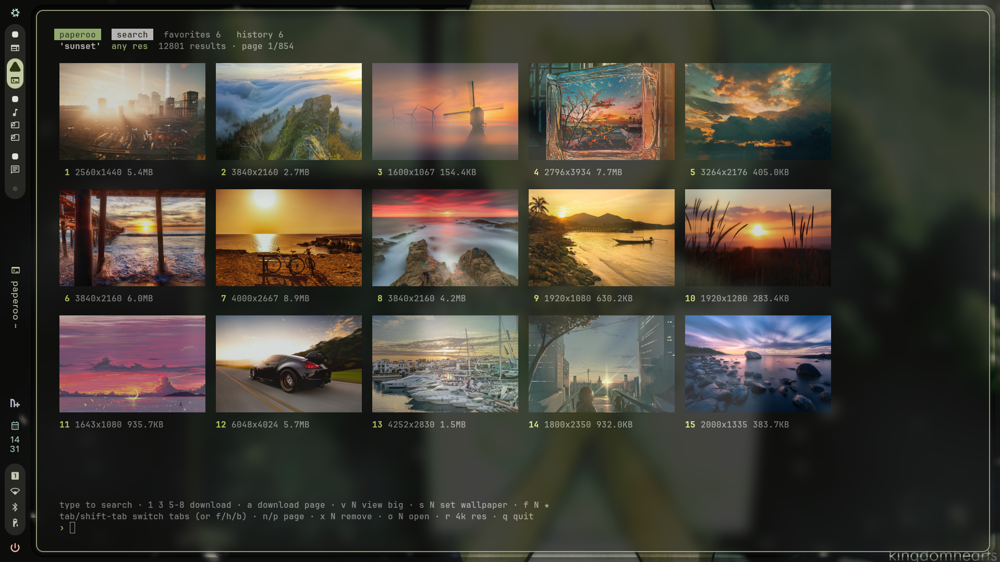

# paperoo

Browse and download wallpapers from your terminal. Search, look through a grid of thumbnails, then pick the ones you want by number.


<a href="https://ko-fi.com/n0va">
  
</a>

Wallpapers come from [wallhaven.cc](https://wallhaven.cc) and are saved to `~/Pictures/paperoo/<search>/`.

### Caelestia

On the [Caelestia](https://github.com/caelestia-dots/shell) shell, paperoo detects it automatically:

- Downloads go to `~/Pictures/Wallpapers/paperoo/<search>/` (or your `paths.wallpaperDir`), so they show up in Caelestia's wallpaper picker.
- `s N` / `--set` uses `caelestia wallpaper -f`, so your colour scheme follows the new wallpaper.

## Install

Only needs Python 3. No pip packages are needed.

```sh
./install.sh            # copies paperoo into ~/.local/bin
```

On Nix: `nix run github:VN0V4/paperoo`, or add the flake's package to your config. The Nix package includes chafa.

### Thumbnails

Thumbnails are drawn with whatever your terminal supports:

- **kitty / Ghostty**: full-quality images via `kitten icat`
- **iTerm2 / WezTerm**: full-quality images, no extra tools needed
- **anything else**: install [`chafa`](https://hpjansson.org/chafa/) for colored block-art previews

Without any of these, results are shown as a text list with links.

## Using the browser

```sh
paperoo                          # open it and type a search
paperoo --4k 'sunset'       # open it with a search already done
paperoo --phone cyberpunk city   # phone (portrait) wallpapers
```

In the browser, type at the `›` prompt:

| Input | Does |
| --- | --- |
| `sunset` | any text starts a new search |
| `1 3 5-8` | download those wallpapers |
| `a` | download everything on the page |
| `v 3` | view #3 as big as the terminal allows (`d` to download, `s` to set) |
| `s 3` | download #3 and set it as your wallpaper |
| `o 3` | open #3 on wallhaven in your browser |
| `f 3` or `f 1-4` | star / unstar wallpapers as favorites (★) |
| `Tab` / `Shift-Tab` | cycle through the search, favorites and history tabs (`f` / `h` / `b` jump straight to one) |
| `x 3` | remove #3 from the favorites or history list you're looking at |
| `n` / `p` | next / previous page |
| `r 4k`, `r 1440p`, `r 3440x1440`, `r any` | change the minimum resolution |
| `q` | quit (Ctrl-C works too) |

If a search finds nothing, paperoo drops words from the end until it finds something.

### Favorites & history

Every wallpaper you set with paperoo goes into **history**, newest first. To switch back to an earlier one, open the history tab (`h`, or `paperoo --history`) and type `s N`. Star anything with `f N` to keep it in **favorites** (`f`, or `paperoo --favorites`).
Both lists are stored in `~/.local/share/paperoo/`. If you've already downloaded a wallpaper, paperoo reuses that file instead of downloading it again.

## Flags

| Flag | Meaning |
| --- | --- |
| `--hd` `--1080p` `--1440p` `--4k` `--5k` `--8k` | minimum resolution |
| `-r, --res WxH` | custom minimum resolution |
| `--exact` | match the resolution exactly |
| `--phone`, `--ultrawide`, `--ratio 16x10` | aspect ratio |
| `-s, --sort` | `relevance` (default), `random`, `toplist`, `views`, `favorites`, `date_added` |
| `--anime` / `--general` | limit the category |
| `-o, --output DIR` | where to save |
| `-f, --favorites` / `-H, --history` | open on that tab (when piped, prints the list) |

### Without the browser (scripts)

```sh
paperoo --4k -y -n 10 'satoru gojo'    # download the top 10 straight away
paperoo --4k -y --set evangelion       # download the top result and set it as your wallpaper
paperoo --4k --list 'studio ghibli'    # print image links
```

When output is piped, paperoo prints links instead of opening the browser.

Setting the wallpaper works with Caelestia, swww, hyprpaper, GNOME, KDE Plasma, swaybg, feh, and macOS.

Only SFW results are shown. Set `WALLHAVEN_API_KEY` to use your wallhaven account's settings.
